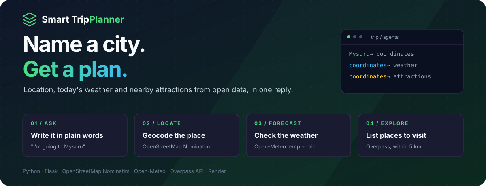
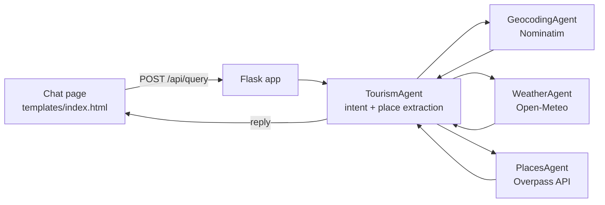

<p align="center">
  
</p>

<p align="center">
  <strong>A multi-agent travel assistant built on open data.</strong><br />
  Type where you are going in plain words and get the location, today's weather and places worth visiting.
</p>

<p align="center">
  <a href="https://tourist-system.onrender.com"></a>
</p>

<p align="center">
  
  
  
  
  
</p>

<p align="center">
  <a href="#the-product">Product</a> ·
  <a href="#engineering-decisions">Engineering</a> ·
  <a href="#architecture">Architecture</a> ·
  <a href="#run-locally">Run locally</a> ·
  <a href="#creator">Creator</a>
</p>

> The live demo runs on Render's free plan. If it has been idle, the first request can take up to a minute while the service wakes up.

---

## The product

Planning a day trip usually means three tabs: a map to find the place, a forecast, and a list of things to see.

**Smart Trip Planner answers all three from one sentence.** Write *"I'm going to Mysuru, let's plan my trip"* and a set of small, cooperating agents find the place, check the weather and list nearby attractions, using only free, open APIs.

| Capability | What you can do |
| :--- | :--- |
| **Plain-language requests** | Ask naturally: "I'm going to Mysuru", "What is the weather in Goa?", "Places to visit in Paris and the temperature". |
| **Place lookup** | The destination is geocoded with OpenStreetMap Nominatim, including its full display name. |
| **Weather** | Current temperature and the day's highest chance of rain from Open-Meteo, in the destination's time zone. |
| **Attractions** | Up to five named attractions and parks within 5 km, from the Overpass API. |
| **Intent-aware replies** | Ask for weather only, places only, or both; a bare city name defaults to places. |
| **Clear failures** | Unknown places, empty results and API errors return a readable message instead of a crash. |

### A workflow you can follow

**Ask → extract the place → geocode → forecast → find attractions → reply**

```text
You:  What is the weather in Mysuru?
Bot:  In Mysuru it's currently 26.1°C with a chance of 100% to rain.
```

*A real reply from a local run on 18 October 2026. Values are live from Open-Meteo; a places request appends up to five attractions on separate lines.*

## Engineering decisions

| Engineering problem | Implementation | Inspect the code |
| :--- | :--- | :--- |
| One request needs three different data sources | Each source has its own agent (`GeocodingAgent`, `WeatherAgent`, `PlacesAgent`); a `TourismAgent` orchestrates them. | [`backend/app.py`](backend/app.py) |
| Users don't type clean city names | The place is cut from the text after "to", trimmed at punctuation and conjunctions, then stripped of stop words like "going", "trip" and "weather". | [`_extract_place`](backend/app.py#L192) |
| Users ask for different things | Keyword intent detection decides between weather, places or both, and defaults to places for a bare city name. | [`handle_request`](backend/app.py#L117) |
| Free public APIs are slow or down sometimes | Every call has a timeout (10 s, 30 s for Overpass); failures are logged and turned into a friendly reply. | [`WeatherAgent`](backend/app.py#L12), [`PlacesAgent`](backend/app.py#L42) |
| Nominatim requires an identifying client | Requests send a descriptive `User-Agent` with a contact address, as its usage policy asks. | [`GeocodingAgent`](backend/app.py#L79) |

## Architecture



- **Backend:** one Flask app ([`backend/app.py`](backend/app.py)) with the agents and two routes: `GET /` and `POST /api/query`.
- **Frontend:** a server-rendered chat page ([`backend/templates/index.html`](backend/templates/index.html)) with its stylesheet in [`backend/static/css`](backend/static/css).
- **Data:** no database and no API keys; everything comes from public OpenStreetMap and Open-Meteo services.

<details>
<summary><strong>Scope and known limitations</strong></summary>

- Intent detection and place extraction are keyword rules, not a language model, so unusual phrasing can pick the wrong words as the place.
- Attractions are limited to OpenStreetMap nodes tagged as attractions or parks within 5 km, so coverage depends on map data.
- Weather is the current temperature plus the day's peak rain probability, not a multi-day forecast.
- Public APIs have rate limits; heavy use should add caching.
- As of 18 October 2026 the Overpass API rejects the app's requests (HTTP 406), so attraction lists come back empty, and the hosted demo also fails to reach the weather API. Geocoding still works there. Local runs return weather.

</details>

## Run locally

```bash
git clone https://github.com/Lingu17/tourist-system.git
cd tourist-system/backend
python -m venv .venv
source .venv/bin/activate          # Windows: .venv\Scripts\activate
pip install -r requirements.txt
python app.py
```

Open [http://127.0.0.1:5000](http://127.0.0.1:5000). Before heavy use, set your own contact email in the `TourismAgent(email=...)` line of `app.py`; Nominatim uses it to identify the client.

**API:**

```bash
curl -X POST http://127.0.0.1:5000/api/query \
  -H "Content-Type: application/json" \
  -d '{"message": "I am going to Mysuru, what is the weather?"}'
```

**Production:** the app is served with Gunicorn on Render, for example `gunicorn app:app` with `backend` as the root directory.

## Project map

```text
tourist-system/
└── backend/
    ├── app.py                 Agents, intent detection, Flask routes
    ├── requirements.txt       flask, requests, gunicorn
    ├── templates/index.html   Chat interface
    └── static/css/styles.css  Styles
```

## Creator

**Lingraj Malipatil** · [GitHub @Lingu17](https://github.com/Lingu17) · [LinkedIn](https://www.linkedin.com/in/lingraj-malipatil-a2735a241/)

---

<p align="center"><strong>Smart Trip Planner</strong><br />Name a city. Get a plan.</p>
